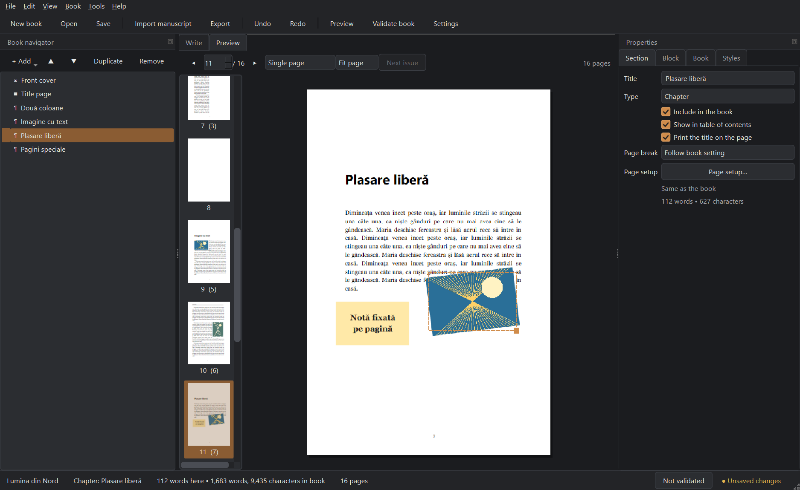
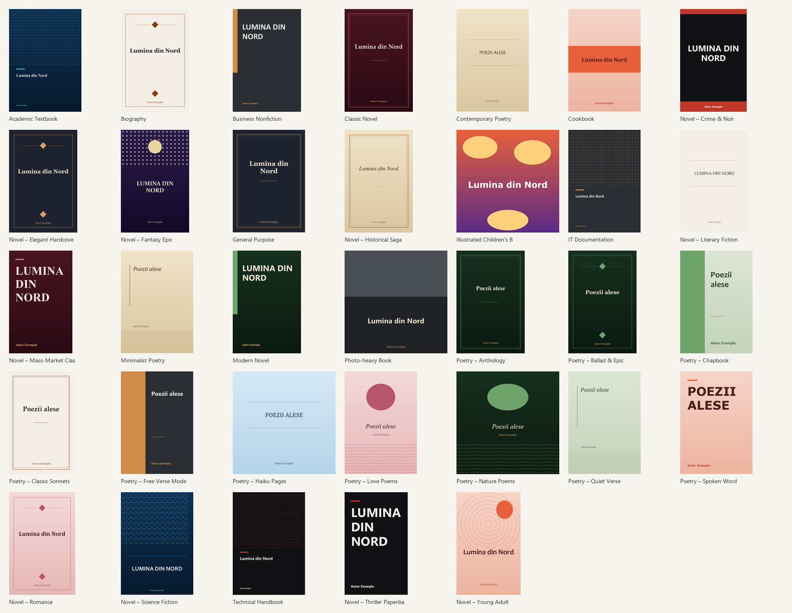
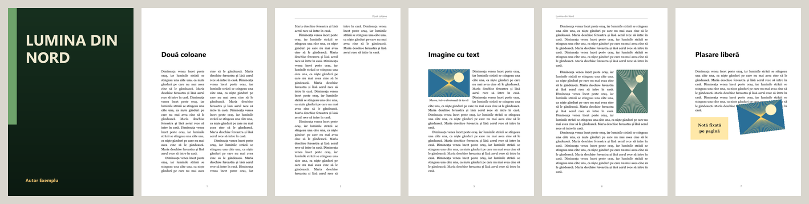
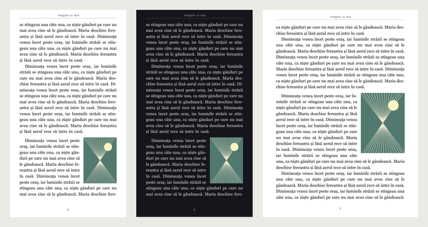
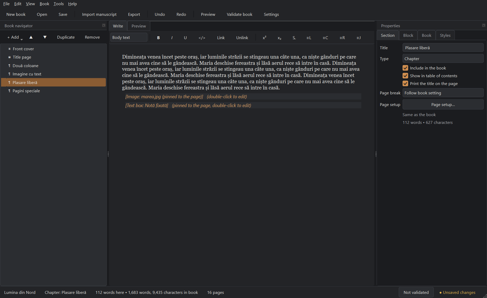

# BookForge Studio

**Turn a manuscript into a finished book – on your own computer.** BookForge Studio is a local-first Windows desktop
app for writing, laying out and publishing books: import a Word, text or Markdown file, pick one of 33 templates, and
export a print-ready PDF, a phone-friendly screen PDF, an EPUB or a Word file. Everything runs offline; your
manuscripts and images never leave your machine.



## About

BookForge Studio grew out of a practical problem: a long poetry collection exported from Facebook had to become a
real book, with every line break and blank line kept, one poem per page, a list of poems and page numbers in the
style of the chosen design. The app is built around that kind of minimal-intervention workflow:

* **Import keeps your formatting.** DOCX bold/italic/links/lists/tables/images survive; poems are detected and keep
  every line, indent and stanza; "one post per poem" exports are split into individual poems.
* **One layout engine for everything.** The preview and the PDF are drawn from the very same page description, so what
  you see is what is exported. Hyphenation, widow/orphan control and poem fitting are handled for you.
* **33 templates with their own covers** – 10 novel and 10 poetry designs among them – each with matching cover,
  title page, chapter openings, running heads and folios.
* **Real page layouts**: columns, floated images with text wrapping, pinned images and text boxes you can drag in the
  preview, full-page photos with caption overlays, image-beside-text pages, and per-section page size and margins.
* **Outputs for every use**: print PDF with bleed and crop marks, a screen PDF for phone, tablet or computer (with a
  dark-pages option), EPUB 3, DOCX, HTML, Markdown, and print cover artwork.
* **Honest about limits.** Nothing is faked: see [docs/limitations.md](docs/limitations.md) for exactly what is and is
  not implemented.

| Templates, each with its own cover | Page layouts |
|---|---|
|  |  |



## Download

Get the Windows installer from the [latest release](../../releases/latest): run
`BookForgeStudio-Setup-<version>.exe`; it installs to *Program Files* and adds a Start-menu entry. The installer is not
code-signed, so Windows SmartScreen may ask you to confirm ("More info ▸ Run anyway"). Windows 10/11, 64-bit.



## Quick start

Requirements: Windows 10/11, Python 3.11+ (developed and tested on Python 3.13).

```bat
scripts\run_windows.bat          :: creates .venv on first run, installs requirements, starts the app
scripts\run_tests.bat            :: runs the automated test suite headlessly
scripts\build_windows.bat        :: builds dist\BookForgeStudio\BookForgeStudio.exe and self-tests it
```

Manual equivalent:

```bat
python -m venv .venv
.venv\Scripts\python -m pip install -r requirements.txt
.venv\Scripts\python main.py                       :: start
.venv\Scripts\python main.py path\to\book.bookforge
.venv\Scripts\python main.py --selftest out-folder :: headless end-to-end check (also works in the built .exe)
```

## What you can do

| Step | How |
|---|---|
| Create a book | **File ▸ New book** – wizard with 10 category profiles and 33 templates (incl. 10 novel and 10 poetry designs). **File ▸ New book from manuscript** builds a finished book straight from a DOCX/TXT/Markdown file |
| Import a manuscript | **Import** (Ctrl+I): DOCX, TXT (any encoding), Markdown, HTML, text of PDFs. You see an import report before anything is added. Originals are never modified; a snapshot is stored in the project. Bold/italic/underline/strike, super/subscript, centring, indents and spacing that differ from the body text are kept; poems are recognised (or forced via the Poetry option) and keep every line, indentation and blank line; "Chapter N" lines become chapters when the file has no Heading styles. Collections exported one post per poem (bold header, poem, hashtag, separator) are split into individual poems; numbered date headers can be kept, shortened to the number (default) or removed, and a hashtag repeated on every post is dropped (default) |
| Organise | Book navigator: add / rename / duplicate / hide / remove, drag-and-drop or Alt+↑/↓, nested sections |
| Write | Rich-text editor on structured blocks: headings, bold/italic/underline, inline code, links, lists, quotes, code blocks, poetry (line breaks kept), scene breaks, images with captions, tables, recipes, textbook callouts, find & replace |
| Design | **Book** tab: page size, margins (mirrored, gutter), typography, running headers/footers, numbering. **Styles** tab: edit any named style. **Templates**: preview, apply, duplicate, import/export, save your setup as a template |
| Cover | **Book ▸ Cover design**: layered designer (text, images, rectangles, ellipses, lines, frames, 6 generated patterns), 10 presets, 8 palettes, image filters (B&W, sepia, brightness, contrast, saturation, blur, colour wash, flip), drag/resize/rotate, front and back. Exports: front PNG/PDF (digital), print front+back with bleed and crop marks, and a print wrap-around (back + spine + front) using your paper thickness |
| Layout | **Section ▸ Page setup**: columns, own margins and page size per section. **Insert ▸ Page layout**: photo page with caption, image beside/over text, quote page. **Insert ▸ Text box**; images can float (text wraps) or be pinned to an exact spot |
| Preview | **Preview** tab (F5): thumbnails, single page or two-page spread, zoom, click a block to jump to it, pages with problems are outlined; **drag, resize and nudge pinned images and text boxes right on the page** |
| Polish | **Book ▸ Typography cleanup**: typographic quotes (Romanian „ ”, English, German, French), dashes, ellipses, spacing, undoable. **Hyphenation** (Book tab, book language). **Pad page count** to a multiple of 2/4/8/16/32 for printers. **List of poems** in the contents. **Statistics**. **Go to** (Ctrl+G): page, chapter, heading or poem by name. Search supports **regular expressions**. Navigator ▸ **Organise**: split a long section into one section per poem or at headings, merge sections |
| Check | **Validate** (F7): missing images, missing glyphs, low-resolution images, overflow, accidental blank pages … double-click an issue to jump to it |
| Export | **Export** (Ctrl+E): Digital / Print / Proof PDF, **EPUB 3**, DOCX, HTML, Markdown; **Export all formats** (Ctrl+Shift+E) writes a whole set into one folder, one format failing never stops the rest. Validate → review → write to a temp file → verify → atomic finalise. Existing files are never overwritten silently |
| Save | `.bookforge` project (ZIP: JSON manifest + assets + original sources). Atomic saves keep a `.bak`; autosave + crash recovery |

Keyboard shortcuts: **Help ▸ Keyboard shortcuts**.

## Architecture in brief

```
app/domain        semantic document model (no Qt, no ReportLab): blocks, sections, styles, settings
app/layout        measurement, flows, pagination → LayoutResult (the ONE shared page description)
app/exporters     pdf (ReportLab) / docx / html / markdown – the PDF exporter only draws the LayoutResult
app/ui/preview    QPainter renderer of the same LayoutResult
app/importers     txt / markdown / html / docx / pdf → blocks + import report
app/persistence   .bookforge archive, atomic save, path-traversal-safe load, schema migrations
app/services      project/template/import/export/validation/search/autosave services
app/workers       background tasks and the debounced layout controller
app/ui            PySide6 widgets (navigator, editor, properties, preview, dialogs, theme)
app/templates     built-in templates as JSON (data, not code)
```

Details and design decisions: [docs/architecture.md](docs/architecture.md).

## Testing

`scripts\run_tests.bat` (or `pytest`) runs about 400 tests that inspect real output: PDFs are opened with PyMuPDF
(page size, metadata, extracted text incl. Romanian diacritics, embedded fonts, bookmarks, links, image bounding
boxes, text positions versus the layout model), DOCX files are re-read with python-docx, archives are attacked
with traversal / corruption / interruption scenarios, and the UI is driven headlessly with Qt's offscreen platform.

## Fonts

Layout uses TrueType fonts found on the machine (Windows ships Georgia, Cambria, Times New Roman, Segoe UI, Arial,
Calibri, Consolas …); ReportLab's Vera fonts are the last-resort fallback. Fonts are embedded as subsets in PDFs.
**You are responsible for checking that your fonts' licences permit embedding.** The validator warns when a font
lacks glyphs used by your text. Put extra `.ttf` files in `assets/fonts/` or point `BOOKFORGE_FONT_DIR` at a folder
(file names must match the table in `app/layout/typography.py`).

## Data locations

`%APPDATA%\BookForgeStudio\` – `settings.json`, `window.ini`, `templates\` (your templates), `recovery\`
(autosave), `bookforge.log` (events only, no manuscript text). Override with `BOOKFORGE_DATA_DIR`.

## License

No license has been chosen yet, so all rights are reserved by the author until one is added. Third-party components
(PySide6/Qt, ReportLab, python-docx, Pillow, pyphen, and PyMuPDF – which is AGPL-3.0 or commercially licensed) keep
their own licenses. Choosing the project's license has to take them into account, in particular PyMuPDF's AGPL, which
affects anyone who redistributes a build.
